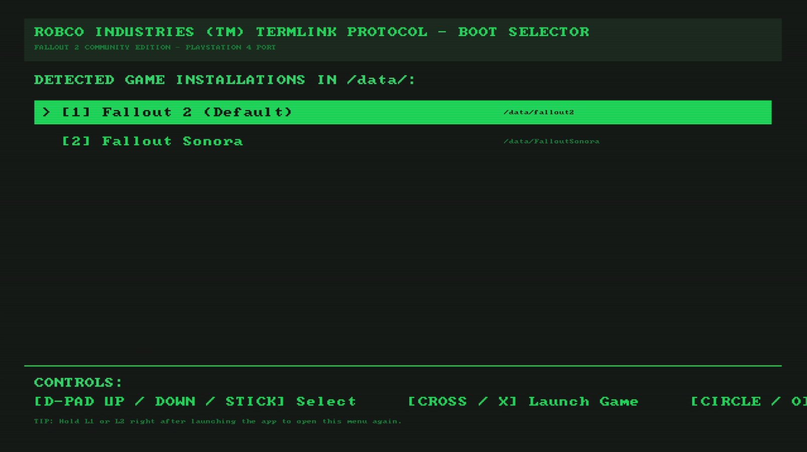
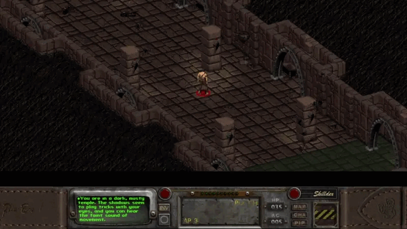
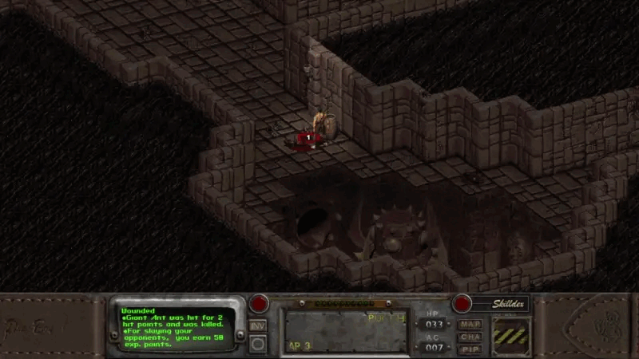

# Fallout II Community Edition — PS4 Port

PlayStation 4 homebrew port of [fallout2-ce](https://github.com/fallout2-ce/fallout2-ce) (Fallout 2 Community Edition) built with the OpenOrbis toolchain.

- **100% Native Presentation:** Renders via native `sceVideoOut` flip queues — **zero proprietary Sony modules needed**.
- **Engine-only Package:** No copyrighted game assets are bundled. You provide your own Fallout 2 PC data files.
- **DualShock 4 Gamepad Support:** Smooth analog camera & cursor, trackpad pointer via DS4 Touchpad, combat target snap (L2), called-shot VATS (L2 + R2), and loot/door assist (L2 + L1).
- **Custom boot menu:** Detects every game/mod folder on your console and lets you pick which one to launch — hold **L1** or **L2** while the app starts to open it.

<table>
  <tr>
    <td align="center">
      <br>
      <sub><b>Mod selection boot menu</b> — auto-detects Fallout 2, Sonora, Nevada, RPU… (hold <b>L1</b> or <b>L2</b> at launch)</sub>
    </td>
  </tr>
  <tr>
    <td align="center">
      <br>
      <sub><b>Combat aim assist</b> — hold <b>L2</b> to snap the reticle onto the nearest enemy (D-pad cycles targets)</sub>
    </td>
    <td align="center">
      <br>
      <sub><b>Loot assist</b> — hold <b>L2 + L1</b> to snap onto containers, corpses and doors</sub>
    </td>
  </tr>
</table>

---

## Installation & Setup

### 1. Requirements
- A jailbroken PS4 running **GoldHEN** — tested and verified on **firmware 9.00** (other GoldHEN firmwares 5.05–11.00 are expected to work; feedback and reports in GitHub Issues are welcome).
- Your own copy of Fallout 2 for PC (GOG, Steam, or original CD).

### 2. Copy Game Data
Transfer your game files via FTP (e.g. GoldHEN FTP server on port 2121) to **`/data/fallout2/`** on the console, or copy a game folder directly onto a pendrive / external SSD/HDD.

Required files: **`master.dat`**, **`critter.dat`** and **`ce.dat`**. Recommended: `patch000.dat`, `data/`, `sound/` and `f2_res.dat`.

> **IMPORTANT — `ce.dat` is required:**
> `ce.dat` contains Community Edition specific UI assets, perks, and font resources. Download `ce.dat` from the official [fallout2-ce Releases](https://github.com/fallout2-ce/fallout2-ce/releases) and copy it directly into the game folder.

> **`f2_res.dat` (Recommended for 1080p):**
> For widescreen/1080p rendering, copy `f2_res.dat` from the upstream [fallout2-ce files directory](https://github.com/fallout2-ce/fallout2-ce/tree/main/files) into the game folder. Without it, the interface bar remains at original 640×480 proportions.

*Note: Filenames and directories can be in any casing (lowercase, uppercase, or mixed).*

If you are planning to copy multiple mods, make sure the mod's name is in the game folder name (for example `falloutsonora`) — this way the boot menu will show the correct title in the list:

| Folder name | Title shown |
|---|---|
| `fallout2` | `Fallout 2 (Default)` |
| `falloutsonora` / `sonora` | `Fallout Sonora` |

Supported names, but mods are not tested:

| Folder name | Title shown |
|---|---|
| `fallout_nevada` / `nevada` | `Fallout Nevada` |
| `olympus2207` / `olympus` | `Olympus 2207` |
| `fallout1` / `fallout_et_tu` | `Fallout 1 (et tu)` |
| `fallout2_rpu` / `rpu` | `Fallout 2 (RPU Restoration Project)` |

### 3. Install the PKG
Download the latest `.pkg` file from [Releases](../../releases) and install it via **GoldHEN Debug Settings → Package Installer**.

Saves are stored in **`/game_folder/SAVEGAME/`** and persist across PKG updates and reinstalls.

---

## Controls (DualShock 4)

### Default Mapping

| Input | Action |
|---|---|
| **Left Stick** | Camera pan with cursor centered (frees at map edges) |
| **Right Stick** | Free trackpad-style cursor pointer |
| **Touchpad (Slide / Tap)** | Trackpad cursor motion / Left click |
| **Touchpad (Physical Click)** | Open Pipboy |
| **Cross ✕ (Tap)** | Left click / Confirm / Attack target |
| **Cross ✕ (Hold on Object)** | **Action Menu:** Open Talk / Look / Use / Push menu (D-pad to pick) |
| **Circle ○** | Right click (cycle cursor mode) / Back / Cancel |
| **Square ◻** | Open Skilldex |
| **Triangle △** | Open Character Sheet |
| **L1** | Open Inventory |
| **R1** | Reload equipped weapon (spends AP in combat) |
| **L2 (Hold)** | **Combat Aim Assist:** Snap reticle to nearest enemy (D-pad to cycle) |
| **L2 (Hold) + R2** | **Called Shot (VATS):** Open body-part targeting window |
| **L2 + L1 (Hold)** | **Loot Assist:** Snap to nearest container, corpse, or door |
| **L3 (Click Left Stick)** | Swap hands (switch secondary weapon) |
| **R3 (Click Right Stick)** | Initiate combat / End turn (or exit combat if safe) |
| **Options** | Escape (Game menu / Cancel / Skip cutscenes) |
| **D-Pad** | Arrow keys / Navigate action menus & inventory |

### Customizing Controls
All button bindings, analog stick behaviors, aim-assist ranges, and touchpad sensitivity parameters can be customized via **`ps4_controls.cfg`** in the game folder (automatically generated on first boot, editable over FTP).

For full details on remapping actions and fine-tuning parameters, see the **[Controller Configuration Guide](docs/controller-mapping.md)**.

---

## Troubleshooting

- **Black screen or immediate close on boot:**
  1. Confirm that `master.dat` and `critter.dat` are present and readable in the game folder.
  2. Confirm that `ce.dat` was copied from the fallout2-ce release.
  3. Ensure permissions on the game folder allow read/write access.
- **Save game error:**
  Make sure the game folder is writable over FTP; the engine automatically creates the `SAVEGAME/` directory on first save.
- **Boot menu shows the wrong title:**
  Rename the game folder to one of the recognised names above, or drop a `title.txt` in the folder with the name you want on the first line.

---

## Building

This repository is maintained as a **thin overlay** (`overlay/` + `patches/`) on top of upstream [fallout2-ce](https://github.com/fallout2-ce/fallout2-ce). See [docs/porting-notes.md](docs/porting-notes.md) for architecture details.

### GitHub Actions (Cloud Build)
1. Go to **Actions → build-ps4 → Run workflow**.
2. Leave `upstream_ref` blank (builds the verified upstream CE commit) or enter `main` to build the latest CE development branch.
3. The workflow builds the package with OpenOrbis and automatically publishes it to [Releases](../../releases).

### Building Locally (Linux / WSL)
Requires the **OpenOrbis Toolchain** (Clang-based) and portlibs (`SDL2`, `zlib`), installed e.g. via PacBrew (`ps4-openorbis`, `ps4-openorbis-portlibs`):
```sh
source /opt/pacbrew/ps4/openorbis/ps4vars.sh   # or your $OPENORBIS/ps4vars.sh path
scripts/build.sh
```
The resulting package will be output to the repository root as `IV0001-FALL20002_00-FALL200020100000.pkg`.

*(Optional)*: To use a custom application icon, place a 512×512 PNG at `icon0.png` in the repository root before building.
